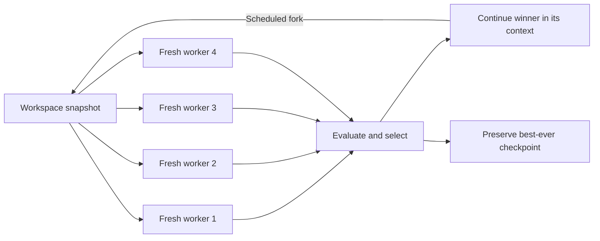

# Fork and Flush

[](https://github.com/hetankevin/fork-and-flush/actions/workflows/check.yml)
[](LICENSE)
[](skills/fork-and-flush/SKILL.md)

A Claude Code and Codex skill implementing
[Fork-and-Flush: Escaping Idea Basins in Autoresearch Agents](https://arxiv.org/html/2610.07447v1).
It runs several agents from the same workspace with fresh chat contexts, evaluates
their results, and continues the best-performing branch under a fixed compute
budget. It is intended for optimization tasks with a reproducible evaluator.

The host agent runs the search using the included instructions and runtime
adapters. Python helpers plan budget allocations and select scored checkpoints.
The installer has no external dependencies. The package requires no additional
API key and includes no daemon or model.



## Install

Requires Python 3.9+ and a host with skills support. Git is needed for cloning
and recommended for workspace isolation.

```sh
git clone https://github.com/hetankevin/fork-and-flush.git
cd fork-and-flush
python3 scripts/install.py --target both
```

| Target | Default installation |
| --- | --- |
| Codex | `~/.agents/skills/fork-and-flush/` |
| Claude Code | `~/.claude/skills/fork-and-flush/` |

For Codex installations that discover skills under `~/.codex/skills`, use:

```sh
python3 scripts/install.py --target both --codex-dir ~/.codex/skills
```

Use the location supported by your installed host. Avoid installing two separate
copies into roots scanned by the same host. See the official
[Codex skill documentation](https://learn.chatgpt.com/docs/build-skills) and
[Claude Code skill documentation](https://code.claude.com/docs/en/skills).
The installer respects custom roots through `--codex-dir` and `--claude-dir`.
It does not change application settings or install either application.

An identical installation is a no-op. A different existing skill is preserved
unless `--replace` is supplied, which backs it up outside the discovery root.
To update, pull this repository and rerun the same installation command with
`--replace`. To uninstall, remove only the installed `fork-and-flush` directory
from the chosen skill root. Start a new session if the host does not discover
the skill on the next turn.

## Use

In Codex:

```text
$fork-and-flush Optimize this solver using the existing benchmark and correctness
checks. Set B to 1,000,000 aggregate input-plus-output model tokens across all
search workers, including discarded branches and retries. Keep the current model
and reasoning effort fixed. Use four branches, 6% of B per branch per round, and
forks at 0%, 33%, and 66% of B. Meter usage in the host at episode boundaries and
keep budgets out of worker prompts. Return the best verified checkpoint and
actual usage. Confirm metering before launch and report coordinator costs
separately.
```

In Claude Code, use `/fork-and-flush` with the same task details.

The agent establishes a run contract, isolates workspaces, and starts independent
workers. You need a measurable objective, a fixed evaluator, and metered model
usage. The paper budgets token-derived compute credits. This example explicitly
chooses raw input-plus-output tokens, which weights usage differently from
provider costs. [Examples](examples/README.md) also cover credits and dollar
budgets. Reasoning effort stays fixed and is not the budget unit.
The skill can also be selected automatically for matching optimization tasks.
It does not apply to ordinary edits or unscored brainstorming.

## What runs

| Phase | Default behavior |
| --- | --- |
| Explore | Four workers receive identical files and fresh chat contexts |
| Select | Rank valid, independently measured checkpoints, including the incumbent |
| Exploit | Continue the winner with its conversation intact |
| Repeat | Fork again at fixed aggregate-spend milestones |
| Finish | Re-verify and return the best artifact found anywhere in the run |

The default schedule starts exploration at 0%, 33%, and 66% of the full search
budget B, with 6% per worker per round. All workers count against B. With 10,000
compute credits, each of the three rounds costs 2,400 credits, leaving 900, 900,
and 1,000 credits for continued work. No overhead deduction changes B. Actual
usage drives interventions at episode boundaries. Budgets stay in the
coordinator's contract and are not disclosed in worker or continuation prompts.

```sh
python3 skills/fork-and-flush/scripts/control.py plan --budget 10000 --unit credits
python3 skills/fork-and-flush/scripts/control.py select examples/round.json
```

The selector supports both maximization and minimization, rejects invalid or
malformed records, preserves an equally good incumbent, and selects the best
checkpoint rather than the last mutable workspace. [See the examples](examples/README.md).

## Runtime requirements and limits

The full protocol requires fresh worker contexts, separate writable workspaces,
a way to resume the winning session, and resource accounting. A context summary
or a transcript-preserving conversation fork is not a flush. Workers must not
share a mutable checkout.

When concurrent slots are limited, the skill can run the same K workers in waves
from an unchanged snapshot. It reports that adaptation and any extra context
resets. If the host cannot meter model usage and control episodes, the skill
prepares a plan and explains the missing capability before launching. It does
not silently substitute minutes, evaluator counts, or worker token estimates.
A user-specified operational timeout is separate from the search budget.

See [budget accounting](skills/fork-and-flush/references/budgets.md) for token
categories, fixed cost rates, episode overshoot, and reporting coordinator costs
separately. Existing overall user spending caps still apply. The planner's
`--unit` is `credits` by default, with `tokens` and `cost-microusd` alternatives.
It accepts integer units: 100,000,000 microdollars represents $100. Schedule
output is schema version 2; score-record schema remains version 1. The former
`--overhead` option has been removed so schedule fractions apply to the full B.

The Python helpers plan allocations and rank supplied records. They do not
launch agents, verify measurements, enforce spending, or integrate code. Those
operations belong to the host agent following the skill. No benchmark gains are
claimed for this package, and the paper's experimental results have not been
reproduced here.

## Inside the repository

- [SKILL.md](skills/fork-and-flush/SKILL.md): the portable procedure and worker brief.
- [Runtime adapters](skills/fork-and-flush/references/runtimes.md): context boundaries, workspace isolation, resumption, and capacity.
- [Budget accounting](skills/fork-and-flush/references/budgets.md): metering, cost/token units, episode boundaries, and worker prompts.
- [Record format](skills/fork-and-flush/references/records.md): contracts, ledgers, artifacts, and score evidence.
- [Method notes](skills/fork-and-flush/references/method.md): attribution and explicit adaptations.
- [Examples](examples/README.md): invocation and a synthetic selection example.
- [Tests](tests): budget conservation, ranking, failure handling, and installation behavior.

## Development

```sh
python3 -m unittest discover -s tests -v
```

The helpers and tests use only the standard library. CI runs on macOS and Linux
with Python 3.9 and 3.13. Changes should preserve budget conservation, fresh
exploration contexts, serial continuation, and best-ever artifact retention.
See [CONTRIBUTING.md](CONTRIBUTING.md) and [HANDOFF.md](HANDOFF.md).

## Attribution

The algorithm is due to Ziyang Cai, Christos Ziakas, Vasilis Kontonis, Tim Pearce,
Siddhartha Sen, Akshay Krishnamurthy, Shivam Garg, and Dimitris Papailiopoulos,
*Fork-and-Flush: Escaping Idea Basins in Autoresearch Agents* (2026),
[arXiv:2610.07447v1](https://arxiv.org/abs/2610.07447v1).

This is an independent skill adaptation, not the authors' official implementation.
The paper is licensed CC BY 4.0. No paper assets or verbatim prompts are bundled.
Original code and documentation in this repository are [MIT licensed](LICENSE).
