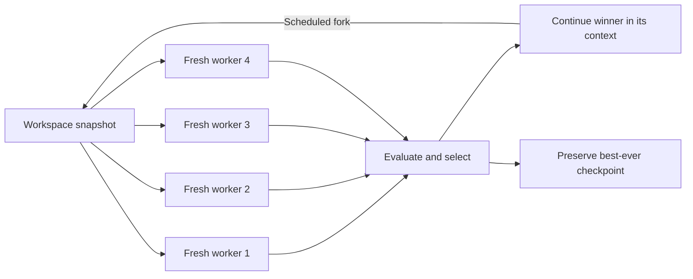

# Fork and Flush

[](https://github.com/hetankevin/fork-and-flush/actions/workflows/check.yml)
[](LICENSE)
[](skills/fork-and-flush/SKILL.md)

**Keep the workspace. Refresh the context. Continue from the best measured result.**

A portable Claude Code and Codex skill for difficult optimization tasks with a
reproducible evaluator. It implements the search workflow described in
[Fork-and-Flush: Escaping Idea Basins in Autoresearch Agents](https://arxiv.org/html/2610.07447v1)
through fresh-context workers, fixed budget allocations, and verified checkpoint
selection.

The package includes the agent instructions, runtime adapters, a deterministic
budget planner, a score selector, and a dependency-free installer. The host agent
coordinates execution. There is no daemon, API key requirement, or bundled model.



## Install

Requires Python 3.9+ and a host with skills support. Git is needed for cloning
and recommended for workspace isolation.

```sh
git clone https://github.com/hetankevin/fork-and-flush.git
cd fork-and-flush
python3 scripts/install.py --target both
```

| Target | Default installation |
| --- | --- |
| Codex | `~/.agents/skills/fork-and-flush/` |
| Claude Code | `~/.claude/skills/fork-and-flush/` |

For Codex installations that discover skills under `~/.codex/skills`, use:

```sh
python3 scripts/install.py --target both --codex-dir ~/.codex/skills
```

Use the location supported by your installed host. Avoid installing two separate
copies into roots scanned by the same host. See the official
[Codex skill documentation](https://learn.chatgpt.com/docs/build-skills) and
[Claude Code skill documentation](https://code.claude.com/docs/en/skills).
The installer respects custom roots through `--codex-dir` and `--claude-dir`.
It does not change application settings or install either application.

An identical installation is a no-op. A different existing skill is preserved
unless `--replace` is supplied, which backs it up outside the discovery root.
To update, pull this repository and rerun the same installation command with
`--replace`. To uninstall, remove only the installed `fork-and-flush` directory
from the chosen skill root. Start a new session if the host does not discover
the skill on the next turn.

## Use

In **Codex**:

```text
$fork-and-flush Optimize this solver using the existing benchmark and correctness
checks. Use four branches and a total allowance of 100 evaluator calls, including
10 reserved for verification. Cap each worker at 10 minutes. Return the best
verified checkpoint and actual resource use.
```

In **Claude Code**, use `/fork-and-flush` with the same task details.

The agent establishes a run contract, isolates workspaces, and starts independent
workers. You need a measurable objective, a fixed evaluator, and a bounded budget.
Evaluator calls in the example are a practical proxy, not token/cost metering.
The skill can also be selected automatically for matching optimization tasks.
It does not apply to ordinary edits or unscored brainstorming.

## What runs

| Phase | Default behavior |
| --- | --- |
| Explore | Four workers receive identical files and fresh chat contexts |
| Select | Rank valid, independently measured checkpoints, including the incumbent |
| Exploit | Continue the winner with its conversation intact |
| Repeat | Fork again at fixed aggregate-spend milestones |
| Finish | Re-verify and return the best artifact found anywhere in the run |

The default schedule starts exploration at 0%, 33%, and 66% of the search
allowance, with 6% per worker per round. All workers count against the global
budget. With a 1,000-unit search allowance, the three rounds cost 240 units each,
leaving 90, 90, and 100 units for continued work. An optional overhead reserve is
subtracted before planning.

```sh
python3 skills/fork-and-flush/scripts/control.py plan --budget 1000 --overhead 100
python3 skills/fork-and-flush/scripts/control.py select examples/round.json
```

The selector supports both maximization and minimization, rejects invalid or
malformed records, preserves an equally good incumbent, and selects the best
checkpoint rather than the last mutable workspace. [See the examples](examples/README.md).

## Runtime requirements and limits

The full protocol requires fresh worker contexts, separate writable workspaces,
a way to resume the winning session, and resource accounting. A context summary
or a transcript-preserving conversation fork is not a flush. Workers must not
share a mutable checkout.

When concurrent slots are limited, the skill can run the same K workers in waves
from an unchanged snapshot. It reports that adaptation. It also reports proxy
budgets and any extra context resets. A skill cannot impose a hard token ceiling
on a host that exposes no metering or cancellation controls.

The Python helpers plan allocations and rank supplied records. They do **not**
launch agents, verify measurements, enforce spending, or integrate code. Those
operations belong to the host agent following the skill. No benchmark gains are
claimed for this package, and the paper's experimental results have not been
reproduced here.

## Inside the repository

- [SKILL.md](skills/fork-and-flush/SKILL.md): the portable procedure and worker brief.
- [Runtime adapters](skills/fork-and-flush/references/runtimes.md): context boundaries, workspace isolation, resumption, and capacity.
- [Record format](skills/fork-and-flush/references/records.md): contracts, ledgers, artifacts, and score evidence.
- [Method notes](skills/fork-and-flush/references/method.md): attribution and explicit adaptations.
- [Examples](examples/README.md): invocation and a synthetic selection example.
- [Tests](tests): budget conservation, ranking, failure handling, and installation behavior.

## Development

```sh
python3 -m unittest discover -s tests -v
```

The helpers and tests use only the standard library. CI runs on macOS and Linux
with Python 3.9 and 3.13. Changes should preserve budget conservation, fresh
exploration contexts, serial continuation, and best-ever artifact retention.
See [CONTRIBUTING.md](CONTRIBUTING.md) and [HANDOFF.md](HANDOFF.md).

## Attribution

The algorithm is due to **Ziyang Cai, Christos Ziakas, Vasilis Kontonis, Tim Pearce,
Siddhartha Sen, Akshay Krishnamurthy, Shivam Garg, and Dimitris Papailiopoulos**,
*Fork-and-Flush: Escaping Idea Basins in Autoresearch Agents* (2026),
[arXiv:2610.07447v1](https://arxiv.org/abs/2610.07447v1).

This is an independent skill adaptation, not the authors' official implementation.
The paper is licensed CC BY 4.0. No paper assets or verbatim prompts are bundled.
Original code and documentation in this repository are [MIT licensed](LICENSE).
